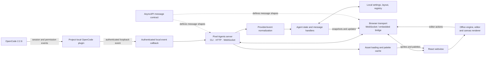

# Architecture

## Overview

Pixel Agents is a local server and browser application that visualizes coding
agent sessions in a pixel-art office. The current integration observes
OpenCode 2.2.6: a project-local plugin forwards supported session and
permission events to the Pixel Agents server. The server translates those
events into agent state and broadcasts updates to connected browser clients.
OpenCode remains responsible for creating and controlling sessions.

GitNexus indexed this repository as **pixel-agents**: 207 files, 3,954
symbols, 8,019 relationships, 131 functional clusters, and 300 execution
flows. The graph snapshot is based on commit `1574d9a`.

## Functional areas

GitNexus clusters code into areas including the following. The graph contains
multiple clusters with repeated labels (such as `Engine` and `Hooks`); these
are related subgroups, not necessarily one package per label.

| Area                          | Responsibility                                                                                                  | Main locations                                                                                                |
| ----------------------------- | --------------------------------------------------------------------------------------------------------------- | ------------------------------------------------------------------------------------------------------------- |
| OpenCode integration          | Discovers supported OpenCode events and relays them to a local Pixel Agents server.                             | `.opencode/plugins/pixel-agents/`, `docs/opencode-integration.md`                                             |
| Server and lifecycle          | CLI startup/shutdown, HTTP and WebSocket endpoints, client message handling, authentication, and session state. | `server/src/cli.ts`, `server/src/server.ts`, `server/src/httpServer.ts`, `server/src/clientMessageHandler.ts` |
| Provider and protocol         | Provider-neutral event/state types, message schemas, adapters, and transport contracts.                         | `core/src/provider.ts`, `core/src/adapter.ts`, `core/src/messages.ts`, `core/asyncapi.yaml`                   |
| Browser UI                    | React application, settings, session cards, and browser-side transport.                                         | `webview-ui/src/App.tsx`, `webview-ui/src/components/`, `webview-ui/src/transport/`                           |
| Office engine and renderer    | Agent/pet simulation, layout and tile rules, rendering, and canvas interaction.                                 | `webview-ui/src/office/engine/`, `webview-ui/src/office/layout/`, `webview-ui/src/office/components/`         |
| Layout editor                 | Editing tools, furniture placement, colors, area management, and undo/redo.                                     | `webview-ui/src/hooks/useEditorActions.ts`, `webview-ui/src/office/editor/`                                   |
| Assets and sprites            | Asset discovery, validation, loading, palette assignment, and browser rendering data.                           | `core/src/assets/`, `server/src/asset*.ts`, `webview-ui/src/office/sprites/`                                  |
| Persistence and configuration | Stores layout, settings, directories, and server registry on the local machine.                                 | `server/src/layoutPersistence.ts`, `server/src/configPersistence.ts`, `server/src/fileStateAdapter.ts`        |
| Tests and developer tooling   | Protocol generation/validation, package verification, and automated tests.                                      | `server/__tests__/`, `webview-ui/src/**/*.test.*`, `scripts/`                                                 |

## Key execution flows

The graph has 300 flows, many of which are fine-grained call paths for UI and
rendering helpers. The following five representative traces show the major
runtime path and common supporting work:

1. **Start the local server** (`Main`, `server/src/cli.ts`): parse CLI options,
   create the `PixelAgentsServer`, initialize persisted configuration and
   runtime services, start HTTP/WebSocket handling, register the instance and
   print its browser URL.
2. **Initialize HTTP/WebSocket services** (`CreateHttpServer`,
   `server/src/httpServer.ts`): load settings/configuration, register health and
   application routes, validate WebSocket origin/authentication, and connect
   the socket handlers to server state and client-message processing.
3. **Handle browser client messages** (`HandleClientMessage`,
   `server/src/clientMessageHandler.ts`): validate the incoming protocol
   message, apply supported state/settings/layout actions through the adapter,
   then return snapshots or broadcast updated state to clients.
4. **Run an OpenCode event through the bridge** (`Main → OpenCodeCallback`,
   `server/src/cli.ts` and the plugin): OpenCode's local plugin forwards an
   event to the authenticated server callback; the server maps supported
   session/tool/permission information into agent state and broadcasts the
   update. OpenCode itself continues to own the session lifecycle.
5. **Render an office frame** (`RenderScene` / `RenderFrame`,
   `webview-ui/src/office/engine/renderer.ts`): read office and agent state,
   select and transform sprites, draw the tile/furniture/character layers, and
   apply palette/color helpers to the canvas.

The knowledge graph also highlights editor flows: UI actions send protocol
messages through the shared transport; server handlers persist changes and
publish updated state. Layout loading/import normalizes furniture, seats, and
pets before updating the office simulation.

## Architecture diagram

## Boundaries and design notes

- OpenCode is an event source, not a process manager for Pixel Agents. The
  integration is observational and does not start or control sessions.
- The server is the boundary between provider events, persisted application
  state, and browser clients. The shared protocol keeps browser/server
  messages explicit and validated.
- The browser can connect over WebSocket when served standalone; the transport
  abstraction also supports an embedded host bridge.
- Layout, settings, and server-discovery data are local. Authentication and
  host/origin validation matter when exposing the server beyond loopback.
- Asset discovery/loading is separated from the office renderer so the server
  can prepare asset data while the browser handles drawing and interaction.
